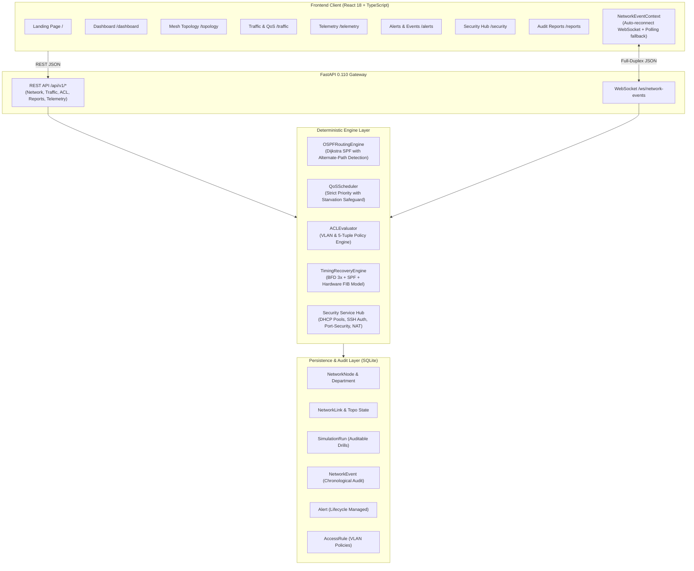

# System Architecture: Disaster-Resistant Emergency Communication Network with Priority Routing

## Educational Simulation Disclaimer
> [!IMPORTANT]
> **Educational Network Simulation Notice**: This software application is an educational simulation platform and experimental software modeling tool. It is **not** a physical Cisco IOS, Junos, or Arista network router controller, nor does it interface with real physical routing hardware. All link latencies, BFD keepalive timers, hardware FIB updates, and queuing delay statistics are **modeled, calculated approximations** executed deterministically by software algorithms (OSPF-inspired Dijkstra Shortest Path First and Weighted Priority Queuing). They must be distinguished from real physical-layer telecommunication measurements.

---

## 1. Executive Summary & Monorepo Architecture

The Disaster-Resistant Emergency Communication Network is a resilient full-stack platform designed to simulate and manage mission-critical packet routing and departmental coordination during municipal emergencies, natural disasters, and infrastructure severances.

The system is organized as a clean, decoupled monorepo:

```
disaster_management/
├── backend/                  # FastAPI 0.110+ Asynchronous Python Application
│   ├── app/
│   │   ├── api/v1/           # Modular REST & WebSocket Route Handlers
│   │   ├── core/             # Database session manager, config, WebSocket hub
│   │   ├── models/           # SQLAlchemy Declarative Models (SQLite)
│   │   ├── schemas/          # Pydantic v2 Request/Response validation models
│   │   └── services/         # Core Algorithmic Engines (Dijkstra, QoS, ACL, BFD)
│   ├── tests/                # 90 Pytest Unit, Integration, & E2E Tests
│   └── requirements.txt      # Python dependencies (SQLAlchemy, FastAPI, Pydantic)
├── frontend/                 # React 18 + TypeScript + Vite + Tailwind CSS
│   ├── src/
│   │   ├── api/              # Strongly-typed HTTP Fetch Clients
│   │   ├── components/       # Layout, Header, Sidebar, Canvas, and Modals
│   │   ├── context/          # NetworkEventContext (WebSocket + Polling Sync)
│   │   ├── pages/            # Dashboard, Topology, Traffic, Telemetry, Alerts, Security, Reports
│   │   ├── types/            # TypeScript Interface Definitions
│   │   └── tests/            # 54 Vitest + React Testing Library Tests (10 suites)
│   ├── dist/                 # Optimized Production Assets
│   └── package.json
└── docs/                     # Specifications and Operating Guides
    ├── ARCHITECTURE.md       # Detailed Systems Architecture Specification
    └── DEMO_GUIDE.md          # 12-Step End-to-End Operational Walkthrough
```

---

## 2. High-Level System Architecture Diagram



---

## 3. Core Engine Specifications

### 3.1. OSPF-Inspired Deterministic Routing Engine
The routing engine implements Dijkstra's Shortest Path First (SPF) algorithm over a weighted graph $G = (V, E)$:
- **Vertices ($V$):** Represent Core Routers (`ROUTER-01` to `04`), Departmental Switches (`SW-ECC` to `SW-BACKUP`), Stations (`HQ-COMMAND-01`, `HOSPITAL-TRIAGE-03`), and Relay Towers.
- **Edges ($E$):** Model physical links with positive cost metrics $C_e > 0$, bandwidth $B_e$ (Mbps), and propagation latency $L_e$ (ms).
- **Cost Formulation:** Base edge cost is proportional to link transmission delay and administrative distance:
  $$C_e = \max\left(1.0, \frac{\text{Ref\_Bandwidth}}{B_e}\right) \times \text{Degradation\_Factor}$$
- **Alternate Route Recalculation:**
  1. The engine computes the baseline primary path $P_{\text{primary}}$ using an unfailed topology ($ignore\_states = True$).
  2. Upon failure injection (link severance or router outage), edges with `operational_state == "DOWN"` or nodes with `status == "offline"` are excluded.
  3. The active path $P_{\text{active}}$ is recomputed.
  4. If $P_{\text{active}} \neq P_{\text{primary}}$, the system marks `alternate_path_selected = True`, generates a route change diff, and recalculates total latency.

### 3.2. Timing Recovery Model (BFD + SPF + FIB)
Rather than fabricating instantaneous or random recovery numbers, recovery duration is deterministically modeled based on telecommunication recovery stages:
- **Detection Delay ($T_{\text{detect}}$):** Modeled Bidirectional Forwarding Detection (BFD) with 3 missed keepalives at 15ms intervals ($3 \times 15\text{ms} = 45.0\text{ms}$).
- **SPF Calculation Delay ($T_{\text{spf}}$):** Logarithmic graph traversal delay based on active vertex count $|V|$:
  $$T_{\text{spf}} = 4.0\text{ms} + 2.5 \times \ln(|V|)$$
- **Hardware FIB Update Delay ($T_{\text{fib}}$):** Hardware Forwarding Information Base rewrite time ($12.0\text{ms}$).
- **Propagation Delay ($T_{\text{prop}}$):** Accumulated path transmission latency ($0.5\text{ms}$ per hop).
- **Total Recovery Duration:**
  $$T_{\text{total}} = T_{\text{detect}} + T_{\text{spf}} + T_{\text{fib}} + T_{\text{prop}}$$

### 3.3. Quality of Service (QoS) & Priority Queuing Scheduler
Modeled over link bottlenecks (e.g., 100 Mbps backbone or 10 Mbps emergency satellite relay):
- **Traffic Classes:**
  1. `CRITICAL`: Ambulance dispatch and hospital triage telemetry (Priority 1, Strict Service).
  2. `HIGH`: Police, tactical, and fire coordination (Priority 2).
  3. `NORMAL`: Inter-departmental logistics and administrative traffic (Priority 3).
  4. `LOW`: Routine communications, volunteer updates, public Wi-Fi (Priority 4).
- **Starvation Safeguard:** To prevent lower priority classes from total starvation under saturation, a minimum service quantum ($5\%$ bandwidth) is guaranteed to Class 4 even during Class 1/2 surges.

### 3.4. Departmental Segmentation & Access Control Evaluator (ACL)
Network segmentation is enforced across 7 departmental VLANs:
- **VLAN 10:** Emergency Control Center (`192.168.10.0/24`)
- **VLAN 20:** Police Station (`192.168.20.0/24`)
- **VLAN 30:** Fire Department (`192.168.30.0/24`)
- **VLAN 40:** Hospital (`192.168.40.0/24`)
- **VLAN 50:** Ambulance Services (`192.168.50.0/24`)
- **VLAN 60:** Relief Camp (`192.168.60.0/24`)
- **VLAN 70:** Backup Control Center (`192.168.70.0/24`)

The ACL engine decouples **Physical Routing** from **Security Authorization**:
- If a route exists physically in the OSPF topology, `path_reachable` evaluates to `True`.
- The ACL engine then evaluates the 5-tuple against ordered database rules. If matched by a `DENY` rule (or the default implicit deny), access is denied, and a persistent `SECURITY_VIOLATION` event is logged to the database and broadcast over WebSockets.

---

## 4. Frontend Resilience & Synchronization Architecture

### 4.1. WebSocket & Polling Fallback State Machine
- **Primary Transport:** Native WebSocket connection to `/ws/network-events`.
- **Heartbeat & Keepalive:** Client periodically issues structured ping frames; backend replies with pong frames.
- **Auto-Reconnect with Exponential Backoff:** If the socket drops, the client attempts reconnection with jitter and bounded exponential backoff ($1\text{s}, 2\text{s}, 4\text{s}, 8\text{s}, \max 15\text{s}$).
- **HTTP Polling Fallback:** If WebSocket remains unreachable after 3 attempts, the client transparently switches to polling `/api/v1/events` and `/api/v1/network/metrics` every 5 seconds, displaying a calm, honest "Polling Fallback" indicator.

### 4.2. Visual & Usability Language
- **Palette:** Coastal emergency-operations pastel palette: powder blue (`#DCEBFA`), lavender (`#EAE6F8`), pale peach (`#FBE6DC`), cream surfaces (`#FAF8F5`), dusty rose action controls (`#C26D75`), and cerulean network highlights (`#2E6F9E`).
- **No Artificial Terminology:** Uses direct networking terminology (*Routing Engine*, *Link State Model*, *Behavioral Detection*, *Prioritized Traffic Schedule*).
- **No Pulsing Effects:** Replaced artificial glowing or pulsing pills with calm rectangular indicators and clean rectangular buttons.

---

## 5. Database Schema & Persistence Model

Persisted in SQLite (`backend/data/disaster_resilience.db`):

| Table | Primary Key | Description |
|---|---|---|
| `network_nodes` | `id` (int), `node_id` (str) | Device configuration, battery level, coordinates, role, IP address, status |
| `network_links` | `id` (int), `link_id` (str) | Edge definition, cost, bandwidth, latency, operational state (UP/DOWN/DEGRADED) |
| `departments` | `id` (int), `code` (str) | Department metadata, subnet, default gateway, VLAN ID (10-70) |
| `traffic_classes` | `id` (int), `code` (str) | QoS class definition, priority level, latency budget, bandwidth allocation |
| `access_rules` | `id` (int), `rule_id` (str) | ACL rules: source, destination, protocol, port, action (PERMIT/DENY), enabled |
| `simulation_runs` | `id` (int), `run_id` (str) | Persistent audit logs of drills, recovery duration, initial/final topologies |
| `network_events` | `id` (int), `event_id` (str) | Chronological forensic event log with severity, affected resource, and details |
| `alerts` | `id` (int), `alert_id` (str) | Active and historical operational alerts (acknowledged, resolved, open) |

---

## 6. Project Credits

Developed for the Disaster-Resistant Emergency Communication Network with Priority Routing:

- **Aahaan Kothari** — 24BDS0273
- **Sara Choudhary** — 24BCT0219
- **Aryan Verma** — 24BCT0223
